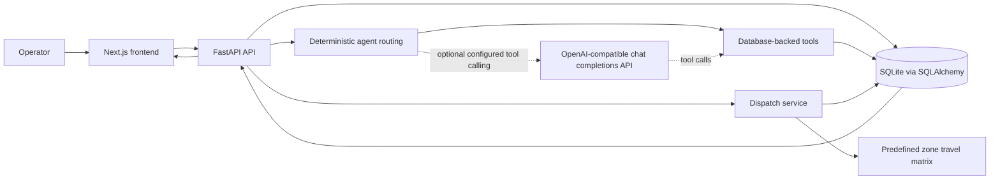
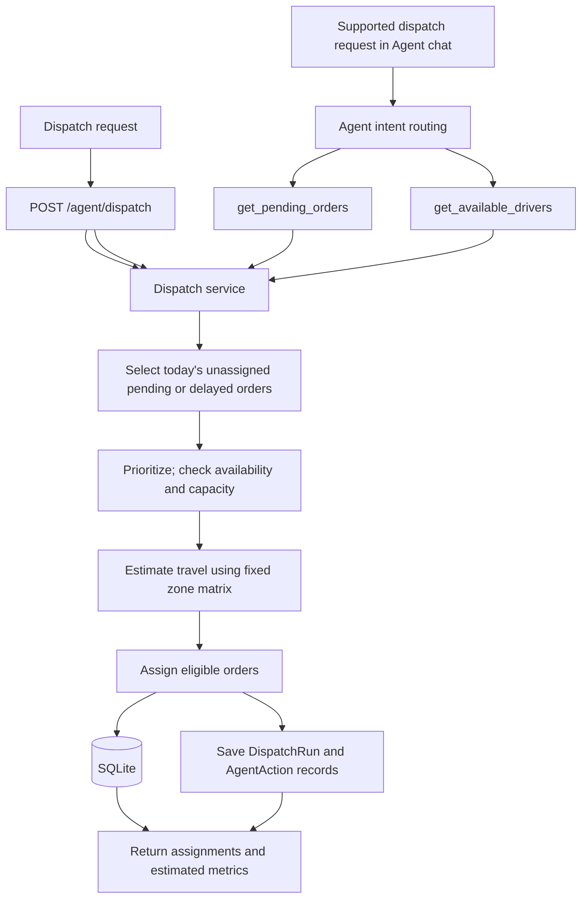

# RouteFlow AI

RouteFlow AI is a logistics operations agent and dashboard for small and medium-sized delivery businesses, with a focus on Egyptian SMEs. It helps dispatchers inspect orders and driver capacity, create a first-pass dispatch plan, and review assignments and activity. The agent connects operational requests to database-backed tools and supported actions, rather than only returning conversational advice.

---

## Problem

Small delivery teams manually review pending orders, identify urgent or at-risk deliveries, check driver availability, estimate routes, assign work, and monitor exceptions. Repeating these checks takes dispatcher time and makes consistent driver allocation harder.

## Solution

RouteFlow AI provides a dashboard and an operations agent that reads current order and driver data. Deterministic intent handling selects tools for supported requests. If configured, an OpenAI-compatible model can select tools through chat completions. The one-click dispatch endpoint applies the project's dispatch rules directly, with or without an LLM provider.

**Dispatch flow:**

```
Business data  →  Agent or dispatch request  →  Tools and dispatch rules  →  Database updates  →  Operational result
```

---

## Application Pages

| Page | Purpose |
|---|---|
| Overview | Today's order, driver, dispatch, and activity summary |
| Orders | Browse, create, assign, and update order status |
| Drivers | Browse and create drivers; review availability and capacity |
| Dispatch | Run dispatch and review assignments and estimated impact |
| Agent | Ask supported natural-language operational questions and request actions |
| Agent Workflow | Inspect the workflow map, available tools, and execution evidence |
| Reports | Review order states, driver utilization, dispatch metrics, and time estimates |
| Activity | Review recorded backend actions with category filters |

---

## Agent Capabilities

Tools are registered in `backend/app/agent/orchestrator.py`.

| Capability | Tools |
|---|---|
| Orders and risk | `get_pending_orders`, `get_today_orders`, `get_urgent_orders`, `get_at_risk_deliveries`, `get_order_details` |
| Drivers and assignments | `get_available_drivers`, `calculate_driver_capacity`, `get_dispatch_plan`, `get_driver_workloads`, `explain_assignment` |
| Operations and estimates | `get_operations_summary`, `get_dispatch_metrics`, `estimate_route` |
| Actions | `assign_order_to_driver`, `reassign_delayed_orders`, `run_dispatch` |

Order status can also be updated through the Orders page via the API; that is not an agent tool. Dispatch does not reorder deliveries after assignment.

### How the Agent Works

1. A user sends a request from Agent or starts dispatch from the dashboard.
2. `POST /agent/chat` checks supported operational intents using deterministic routing.
3. For a matched intent, the orchestrator selects and runs the matching tool against the current database session.
4. If no local intent matches and an OpenAI-compatible provider is configured, the backend sends the request and tool definitions to the provider and executes returned tool calls.
5. Without a provider, unmatched requests receive a database-backed operations snapshot.
6. Dispatch applies availability, capacity, priority, and estimated zone travel rules. Supported actions update the database and write activity records.
7. The backend returns a response and, when applicable, tool calls, actions, updated orders, assignments, and metrics.

The UI shows tool calls and operational results. It does not expose private model reasoning.

### Example Requests

These match deterministic intents in the backend:

- "How many pending orders are there?"
- "Which drivers are available?"
- "Which orders are urgent?"
- "Which deliveries are at risk of being late?"
- "Show today's dispatch plan."
- "Plan today's deliveries."
- "How much time did the latest dispatch save?"
- "Give me today's operations summary."

Intent matching is phrase-based. With an optional LLM provider, other requests may be handled through tool calling. Without one, unmatched prompts receive an operations snapshot.

---

## Architecture



### Agent Tool Flow

The one-click dispatch endpoint calls the dispatch service directly. When a supported dispatch request comes through Agent chat, the orchestrator reads pending orders and available drivers, then calls `run_dispatch`.



---

## Technology Stack

| Area | Technologies |
|---|---|
| Frontend | Next.js 14, React 18, TypeScript, Tailwind CSS, custom CSS and SVG workflow visualization |
| Backend | Python, FastAPI, Uvicorn, Pydantic, SQLAlchemy |
| Database | SQLite by default; database URL is configurable |
| Agent | Project-defined database tools; optional OpenAI-compatible chat completions with tool calling |
| Supporting libraries | HTTPX for provider requests; python-dotenv for environment loading |

The workflow visualization is built in the project UI; no external graph library is used.

---

## Project Structure

```
.
├── README.md
├── data/
│   └── README.md
├── backend/
│   ├── .env.example
│   ├── requirements.txt
│   ├── tests/test_workflow.py
│   └── app/
│       ├── main.py
│       ├── database.py
│       ├── models.py
│       ├── schemas.py
│       ├── seed.py
│       ├── api/          (agent, drivers, operations, orders)
│       ├── agent/orchestrator.py
│       └── services/     (dispatch_service.py, route_service.py)
└── frontend/
    ├── .env.local.example
    ├── package.json
    ├── app/              (overview, agent, activity, dispatch, drivers, orders, reports, workflow)
    ├── components/       (shared shell, data provider, page components)
    └── lib/              (api.ts, types.ts)
```

---

## Installation and Setup

### Requirements

- Python 3.11 or newer
- Node.js and npm
- An LLM API key is optional — deterministic dispatch and local intents work without one

### Backend

Run the following from the repository root in PowerShell:

```powershell
cd backend
python -m venv .venv
.\.venv\Scripts\Activate.ps1
python -m pip install -r requirements.txt
Copy-Item .env.example .env
python -m app.seed
uvicorn app.main:app --reload --port 8000
```

- API: http://localhost:8000
- Interactive docs: http://localhost:8000/docs
- Health check: http://localhost:8000/health

If PowerShell blocks the activation step, run `Set-ExecutionPolicy -Scope Process -ExecutionPolicy Bypass` first, then activate again.

### Frontend

Open a second terminal from the repository root:

```powershell
cd frontend
Copy-Item .env.local.example .env.local
npm install
npm run dev
```

Open http://localhost:3000. `NEXT_PUBLIC_API_URL` defaults to `http://localhost:8000`.

---

## Environment Variables

| Variable | Used by | Required | Purpose |
|---|---|---|---|
| `DATABASE_URL` | Backend | No | SQLAlchemy URL; defaults to `sqlite:///./routeflow.db` |
| `LLM_PROVIDER` | Backend | No | Use `openai` or `openai_compatible` to enable provider calls |
| `LLM_API_KEY` | Backend | No | Provider API key |
| `LLM_MODEL` | Backend | No | Model name for tool calling |
| `LLM_BASE_URL` | Backend | No | Provider base URL; defaults to `https://api.openai.com/v1` |
| `NEXT_PUBLIC_API_URL` | Frontend | No | Backend base URL; defaults to `http://localhost:8000` |

Sample files: `backend/.env.example` and `frontend/.env.local.example`. Do not commit local `.env` or `.env.local` files.

---

## Demo Data and Database

The backend uses SQLite by default and creates tables at startup. On an empty database, it seeds 20 deterministic Cairo-area orders and 8 drivers. Seeding is skipped when the database already contains data.

To reset the demo data, run from the `backend` directory:

```powershell
python -m app.seed --reset
```

This drops and recreates the local database. If a database file already exists, it is copied to a `.bak` file first.

---

## API Endpoints

| Method | Path | Purpose |
|---|---|---|
| GET | `/health` | Backend health check |
| GET, POST | `/orders` | List orders; create an order |
| POST | `/orders/{order_id}/assign` | Assign an order to a driver |
| POST | `/orders/{order_id}/status` | Update an order status |
| GET, POST | `/drivers` | List drivers; create a driver |
| GET | `/drivers/{driver_id}` | Driver details and remaining capacity |
| GET | `/operations/summary` | Current operational metrics |
| GET | `/operations/activity` | Recent recorded activity |
| GET | `/operations/assignments` | Saved delivery assignments |
| GET | `/operations/latest-dispatch` | Latest dispatch and its assignments |
| GET | `/agent/tools` | Agent tool names and schemas |
| POST | `/agent/chat` | Send an operational request, e.g. `{"message": "Plan today's deliveries"}` |
| POST | `/agent/dispatch` | Run today's dispatch workflow |

---

## Business Impact

Dispatch results include orders considered and assigned, drivers used, urgent orders handled, and estimated time saved.

For a completed dispatch run:

- Manual planning = 20 min per order considered
- Agent-assisted planning = 5 min of review + 1 min per order left unassigned
- Estimated time saved = manual estimate − agent-assisted estimate (floored at zero)

Before a dispatch run is recorded, the summary estimates the current queue using available driver capacity. These are planning estimates, not measured labor records.

---

## Recommended Demo Flow

1. Open **Overview** — show the current order queue and available drivers.
2. Open **Agent Workflow** — introduce the request path, tools, dispatch rules, and database.
3. Open **Agent** — ask a supported question such as "Which drivers are available?"
4. Run "Plan today's deliveries" in Agent or click **Run AI Dispatch** on the Dispatch page.
5. Review assignments and estimated time impact in **Dispatch**.
6. Open **Reports** — review updated operational metrics.
7. Open **Activity** — show recorded tool and assignment actions.

To repeat a clean run, reset the database before dispatch.

---

## Verification

Run backend tests from the `backend` directory:

```powershell
python -m unittest discover -s tests
```

Build the frontend from the `frontend` directory:

```powershell
npm run build
```

---

## Limitations

- Route estimates use a predefined zone-to-zone time matrix with a fixed fallback for unknown zones; there is no live maps or traffic integration.
- Demo data is local and deterministic. A reset replaces the current database after making a `.bak` copy.
- Time-saving figures are estimated from dispatch workload, not measured labor records.
- Without optional LLM settings, deterministic routing covers supported requests; unmatched prompts receive a database snapshot.
- The workflow diagram is an architecture map, not a real-time trace of internal backend steps.

---

## Future Improvements

- Live routing and driver-location integrations
- Production authentication and authorization
- Richer historical analytics
- Deployment and scaling for a hosted environment

---

## Hackathon Context

RouteFlow AI was built for the Agents at Work AI-agent hackathon. It focuses on repetitive dispatch work for Egyptian SMEs in logistics and delivery, with operational visibility through database-backed results, recorded actions, and explicit time estimates.

---

## Security Notes

- Store any provider API key in the backend environment file; never put it in frontend code.
- Do not commit local `.env` or `.env.local` files.
- Keep example environment files limited to non-secret defaults and placeholders.

---

## License

No license file was found in the repository.
